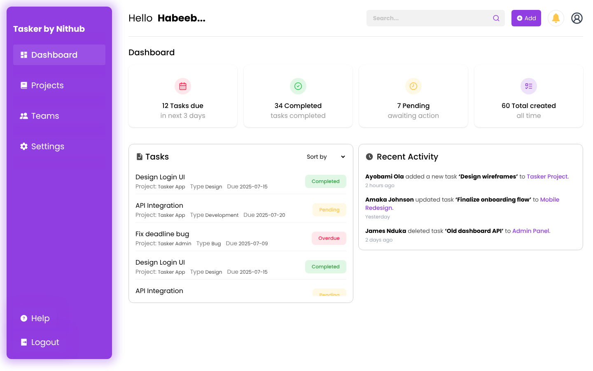
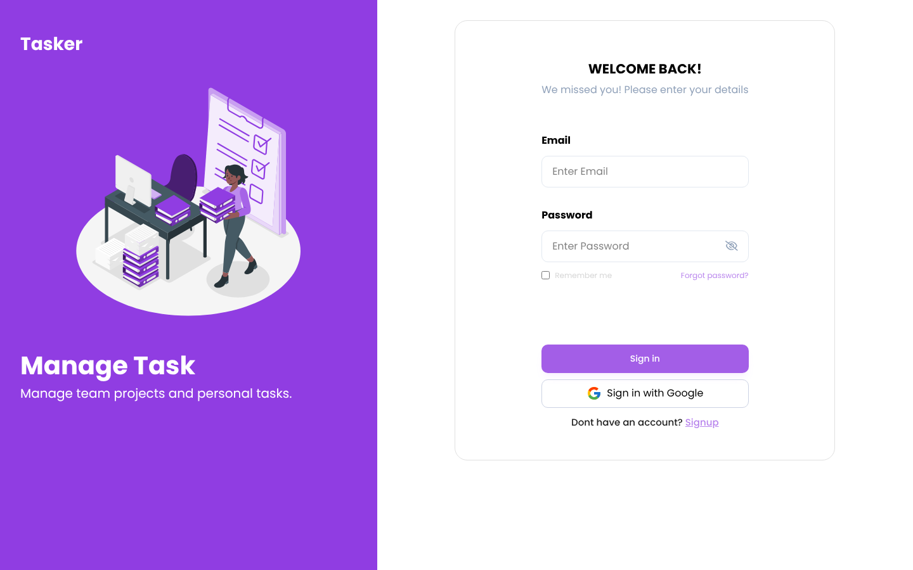
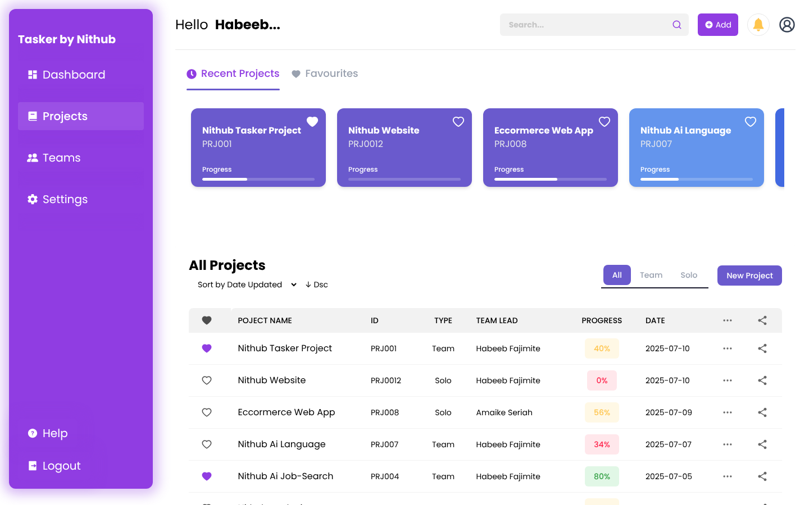
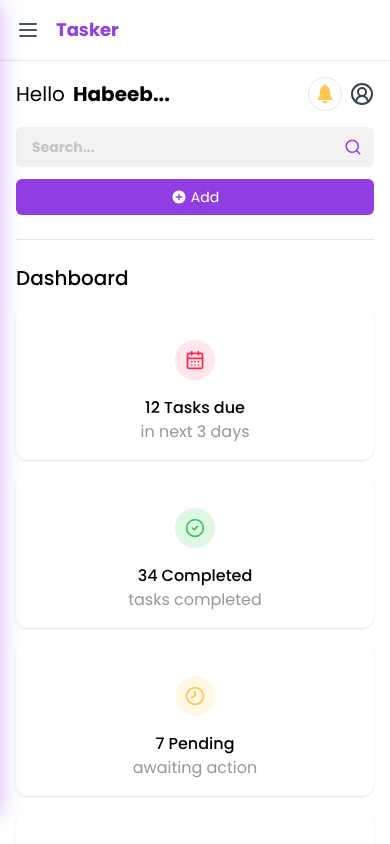

# Tasker

A project and task management web app for teams, built as a frontend team project during my industrial training at **Nithub (NITDA IT Hub), University of Lagos**.



## What it does

- **Authentication flow:** login, sign-up, OTP verification and confirmation screens
- **Dashboard:** task summary cards, a sortable task list with status badges, and a recent-activity feed
- **Projects:** recent and favourite projects, a filterable table of all projects (team or solo), progress tracking per project
- **Project detail:** epics, stories and tasks in a table view, with team members shown on the project
- **Teams and Settings** pages
- **Responsive layout** with a collapsible sidebar on mobile

| Login | Projects | Mobile |
|---|---|---|
|  |  |  |

## Tech stack

- **React 19** with **Vite 7**
- **Tailwind CSS 4** for styling
- **React Router 7** for routing, with nested layouts and a protected-route component
- **React Context** for auth state
- **lucide-react** and **react-icons** for icons
- Deployed with **gh-pages**

## Project structure

```
src/
├── components/     Reusable UI: sidebar, header, cards, tables, tabs
├── context/        Auth context (login/logout state)
├── mock/           Sample projects, epics, stories, tasks and users
├── pages/
│   ├── Auth/       Login, Signup, OTP verification, Thanks
│   └── User/       Dashboard, Projects, Project detail, Teams, Settings
├── Routes/         Route config and protected route
└── utils/          Helper functions
```

## Run it locally

```bash
git clone https://github.com/burjnx/tasker-auth-demov1.git
cd tasker-auth-demov1
npm install
npm run dev
```

Then open http://localhost:5173.

## Status

This is the **frontend only**. It runs on mock data and has no backend or real authentication yet. The team project was paused before the API was built.

## My role

Built in a team using Git branches and pull requests. I built the dashboard, projects page, project detail page and teams page, plus the shared layout and styling.
