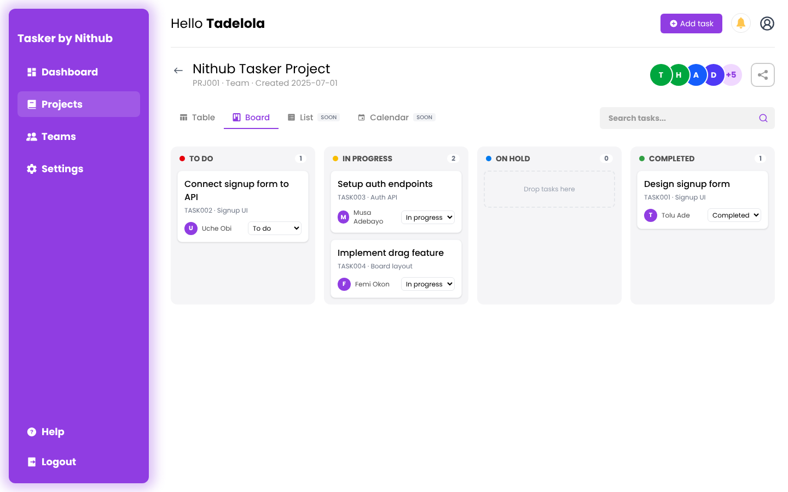

# Tasker

A project and task management web app for teams, built as a frontend team project during my industrial training at **Nithub (NITDA IT Hub), University of Lagos**.

**Live demo:** https://burjnx.github.io/tasker-auth-demov1/
Sign in with any email and password. The demo runs on sample data saved in your browser.


## What it does

- **Sign-up flow:** login, sign-up with validation, OTP verification and a "verified" screen; signed-out visitors are sent to login
- **Dashboard:** live summary cards, a task list you can tick off, filter and search, and a recent-activity feed
- **Add tasks** from any page with a pop-up form
- **Projects:** recent and favourite projects, a sortable table filtered by team or solo, search, and new projects
- **Project page:** epics, stories and tasks in a **Table** view, or a **Board** (kanban) view where you drag cards between To do, In progress, On hold and Completed
- **Teams**, **Settings** (edit profile, reset demo data) and a **Help** guide
- **Responsive:** sidebar on desktop, slide-out menu on tablets and phones

| Projects | Board view | Mobile |
|---|---|---|
|  |  |  |

## Tech stack

- **React 19** with **Vite 7**
- **Tailwind CSS 4**
- **React Router 7:** protected routes, nested layouts, 404 page
- **React Context** for auth, app data and toast messages, saved to `localStorage`
- Native HTML drag and drop for the board, with a "move" menu for touch screens
- **lucide-react** and **react-icons**
- Deployed to **GitHub Pages** with `gh-pages`

## Project structure

```
src/
├── components/     Sidebar, header, cards, tables, board, modals
├── context/        Auth, data and toast providers
├── mock/           Sample projects, epics, stories, tasks and users
├── pages/
│   ├── Auth/       Login, Signup, OTP verification, Verified
│   └── User/       Dashboard, Projects, Project detail, Teams, Settings
├── Routes/         Protected route
└── utils/          Helpers
```

## Run it locally

```bash
git clone https://github.com/burjnx/tasker-auth-demov1.git
cd tasker-auth-demov1
npm install
npm run dev
```

Then open http://localhost:5173. To publish to GitHub Pages: `npm run deploy`.

## Status

This is the **frontend**. The team's backend wasn't completed, so the app runs on sample data and any email signs in. Everything is wired through a data layer, so it can be pointed at a real API later.

## My role

Built in a team using Git branches and pull requests. I built the dashboard, projects page, project detail page and teams page, plus the shared layout and styling. I later completed the frontend on my own: the sign-up flow, protected routes, add-task and new-project forms, search, the Board view, Settings, and the tablet and phone layouts.
